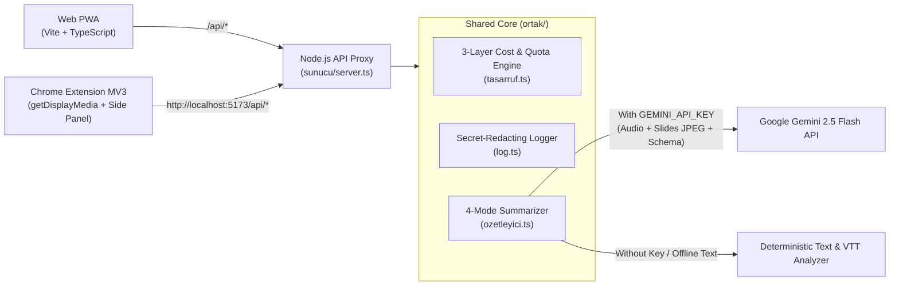

# ⚡ Notly — Multimodal Lecture & Voice-Note Intelligence

[](https://www.typescriptlang.org/)
[](https://vitejs.dev/)
[](https://ai.google.dev/)
[](https://developer.chrome.com/docs/extensions/mv3/intro/)
[](https://vitest.dev/)
[](./LICENSE)

**Notly** is a full-stack multimodal study and audio summarization workspace consisting of a **Bilingual Web PWA (TR/EN)**, a **Chrome Side Panel Extension (Manifest V3)**, and a **Node.js API Proxy Server** with a built-in **3-layer token optimization engine**.

It ingests uploaded recordings (MP3, WAV, M4A, OGG, MP4, WebM), subtitle files (WebVTT, SRT), and live browser/desktop lecture streams—producing structured textbook-style notes, potential exam questions with answers, deadline extractions, and timestamped transcripts in a single pass.

---

## ✨ Key Features

- **4-in-1 Single-Pass Pedagogical Output:** Generates four synchronized study views from a single Gemini 2.5 Flash call—eliminating repeated API calls when switching tabs:
  - ⚡ **Quick Summary (`Hap Özet`)**: Core thesis, timestamped takeaways, and extracted administrative announcements (midterms, deadlines, submissions separated from academic prose).
  - 📋 **Detailed Notes (`Detaylı Anlatım`)**: Academic textbook-grade breakdown stripped of filler chatter and greetings.
  - 🎯 **Exam Prep (`Sınav Soruları`)**: High-yield exam questions with revealable answers and difficulty ratings.
  - 📝 **Full Transcript (`Tam Metin`)**: Speaker-attributed, second-by-second transcript.
- **Multimodal Live Lecture & Slide Capture:** Uses W3C `getDisplayMedia` inside the Chrome Side Panel (avoiding MV3 `activeTab` side-panel context restrictions) to capture crystal-clear slide snapshots alongside audio—letting Gemini inspect formulas, code, and diagrams referenced by the instructor.
- **Compact Recording HUD:** Automatically collapses the Chrome Side Panel into a minimal `40px` floating control bar during live lecture recording (`Timer | 📸 Slide | ⏹️ Stop | ⤢ Expand`).
- **3-Layer Token & Cost Optimization Engine:**
  1. **Layer 1 — Caption-First Parser (`ortak/tasarruf.ts`):** Parses `.vtt` and `.srt` captions to reduce input token usage by **85–95%** compared to raw audio.
  2. **Layer 2 — Compression Telemetry Modeling:** Tracks savings from audio preprocessing (`~45%` token reduction baseline comparison).
  3. **Layer 3 — Per-Client Quota Shield:** Enforces configurable daily rate limits (`DAILY_FREE_LIMIT`, default `3/day`) per client ID.
- **Zero-Exposure Proxy & Log Redaction:** End users never enter credentials into client code; `GEMINI_API_KEY` stays strictly server-side in `.env`, while `ortak/log.ts` automatically masks any accidental `AIza...` secret strings across telemetry logs.
- **Plug-and-Play Runtime Configuration:** Works out of the box for offline VTT/SRT text analysis and built-in sample lectures, and supports configuring `GEMINI_API_KEY` either via `.env` or directly inside the Web UI (**🛠️ Logs & Cost Panel**) / Chrome Extension header (**🔑 API**).

---

## 🏗️ System Architecture



For deep technical details on token economics, privacy/secret masking, and Chrome MV3 capture design, see [`ARCHITECTURE.md`](./ARCHITECTURE.md).

---

## 🚀 Quick Start (Run in Under 2 Minutes)

### Prerequisites
- [Node.js](https://nodejs.org/) **v20+** (`npm` included)
- A **Google AI Studio** API key ([Get a key](https://aistudio.google.com/apikey)) — optional for offline VTT/SRT text testing, **required** for transcribing raw audio/video and live lecture streams.

### 1. Clone & Install

```bash
git clone https://github.com/necmettinsnmz/notly.git
cd notly
npm install
```

### 2. Configure Your Gemini API Key

Choose either option:

**Option A — Environment File (`.env`)**
```bash
cp .env.example .env
```
Open `.env` and set your key:
```env
GEMINI_API_KEY=AIzaSyYourKeyHere
PORT=5173
DAILY_FREE_LIMIT=3
```

**Option B — Configure Directly in the UI (No Editor Needed)**
Start the app first (`npm run dev`), then either:
- In the **Web App** (`http://localhost:5173`), open **🛠️ Log & Cost Panel**, paste your `AIzaSy...` key under **Gemini API Key Configuration**, and click **Save & Activate**.
- Or in the **Chrome Extension Side Panel**, click **🔑 API** in the header and save your key. It automatically persists to `.env` server-side.

### 3. Start the Application

```bash
npm run dev
```

Open **`http://localhost:5173`** in your browser. The Vite server automatically embeds the Notly `/api/*` backend proxy on the same port.

> To run only the standalone HTTP API server (default port `8787`), execute:
> ```bash
> npm run dev:server
> ```

### 4. Load the Chrome Extension

1. Open Google Chrome and navigate to `chrome://extensions`.
2. Toggle **Developer mode** (top right) to **ON**.
3. Click **Load unpacked** (top left) and select the **`eklenti/`** folder inside the cloned repository.
4. Pin **Notly — Akıllı Ders Dinleyici & Sınav Notu** from the toolbar extensions puzzle menu and click it to open the Side Panel on any lecture tab (Moodle, YouTube, Canvas, Zoom Web, etc.).

---

## 🛠️ Available Scripts

| Command | Description |
|---|---|
| `npm run dev` | Starts the Vite Web PWA + embedded Notly API proxy on `http://localhost:5173` |
| `npm run dev:server` | Starts the standalone Node.js HTTP API proxy (`sunucu/server.ts`) |
| `npm run typecheck` | Runs strict TypeScript validation (`tsc --noEmit`) |
| `npm run build` | Type-checks and creates production bundle in `dist/` |
| `npm test` | Executes the Vitest unit & HTTP integration suite (`vitest run`) |
| `npm run test:watch` | Runs Vitest in interactive watch mode |

---

## 🔌 API Endpoints

All API routes are exposed by `createNotlyServer()` in [`sunucu/server.ts`](./sunucu/server.ts):

| Method | Endpoint | Description |
|---|---|---|
| `GET` | `/api/health` | Returns server status, `liveGeminiConnected` boolean, remaining daily quota, and aggregate cost telemetry. Never exposes `GEMINI_API_KEY`. |
| `GET` | `/api/quota` | Returns remaining free requests for the requesting `X-Client-Id`. |
| `POST` | `/api/quota/reset` | Resets daily quota counter for testing (`3/3`). |
| `GET` | `/api/logs` | Returns recent secret-redacted system logs and per-summary cost history. |
| `POST` | `/api/settings/key` | Validates (`AIza...`, ≥ 20 chars) and persists `GEMINI_API_KEY` server-side into `.env` with live reload. |
| `POST` | `/api/summarize` | Executes the 4-mode multimodal summarization pipeline (supports `transcriptOrCaptionText`, Base64 audio, and `slides[]` JPEG snapshots). |

---

## 📁 Project Structure

```text
notly/
├── ortak/                  # Shared isomorphic TypeScript modules
│   ├── ayarlar.ts          # Runtime config, token pricing constants, TR/EN i18n dictionary
│   ├── log.ts              # Secret redactor (AIza masking) & 3-layer cost calculator
│   ├── tasarruf.ts         # WebVTT/SRT subtitle parser & DailyQuotaManager
│   └── ozetleyici.ts       # Gemini 2.5 Flash 4-mode engine + deterministic text fallback
├── sunucu/
│   └── server.ts           # Zero-dependency Node.js HTTP proxy & runtime .env loader
├── web/
│   ├── main.ts             # Bilingual Web PWA controller & Developer Telemetry Panel
│   ├── ornekVeriler.ts     # Sample lecture (with SVG slides) & WhatsApp voice note demos
│   └── style.css           # Impeccable Swiss Editorial dark/light themes + high-contrast print CSS
├── eklenti/                # Chrome Extension (Manifest V3)
│   ├── manifest.json       # MV3 manifest (sidePanel, offscreen, tabCapture, tabs)
│   ├── background.js       # Service worker & side panel lifecycle
│   ├── sidepanel.html      # Compact HUD + tabbed results + drag-and-drop file UI + print styles
│   ├── sidepanel.js        # W3C getDisplayMedia capture, canvas slide snap & API client
│   ├── offscreen.html      # Offscreen media container
│   └── offscreen.js        # Offscreen audio recorder fallback
├── tests/                  # Automated Vitest test suites
│   ├── log-ve-ayarlar.test.ts
│   ├── tasarruf-ve-sunucu.test.ts
│   ├── http-sunucu.test.ts
│   └── eklenti.test.ts
├── DESIGN.md               # Visual design system tokens & anti-slop rules
├── PRODUCT.md              # Product specification & anti-goals
├── ARCHITECTURE.md         # Deep-dive engineering architecture & security notes
└── vite.config.ts          # Vite dev server with embedded API middleware
```

---

## 📄 License

Distributed under the MIT License. See [`LICENSE`](./LICENSE) for details.
